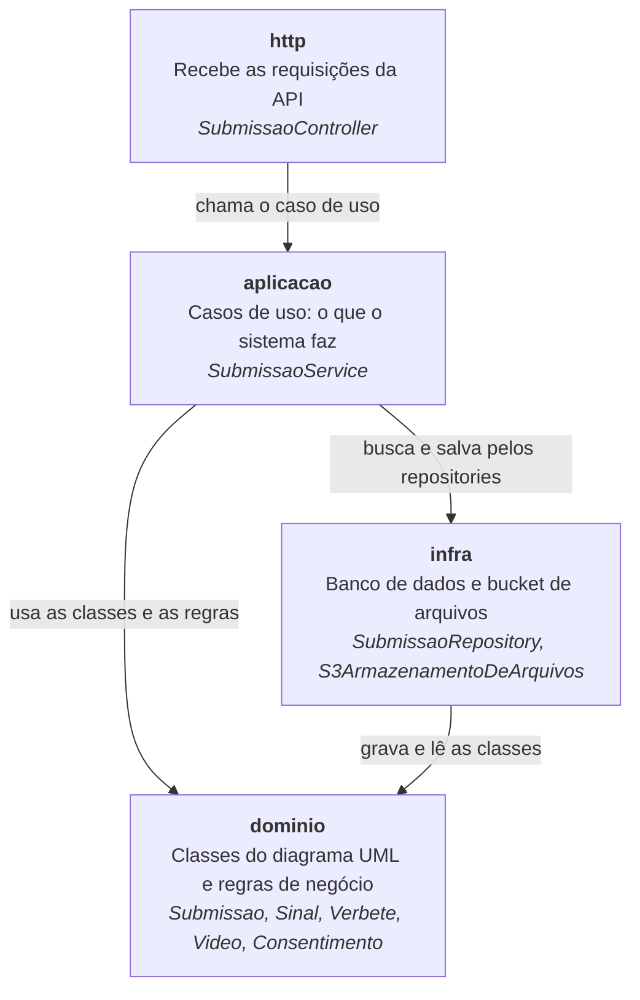

# Apresentação — Expansão do Dicionário de Libras

**AMS0002 – Análise e Modelagem de Sistemas** · Prof.ª Carla Diacui Medeiros Berkenbrock · UDESC

**Equipe:** Gabriel Lima e Eduardo Pasqualeto ·
Repositórios: [documentação](https://github.com/Trabalho-AMS/dicionario-libras),
[backend](https://github.com/Trabalho-AMS/dicionario-libras-backend) e
[frontend](https://github.com/Trabalho-AMS/dicionario-libras-frontend)

## O problema

O [Dicionário de Libras do INES](https://www.ines.gov.br/dicionario-de-libras/) só permite consultar. A expansão
permite **inserir, alterar e excluir** verbetes, registrar **variações regionais** do mesmo sinal (ex.: "Pai" no
padrão nacional, no RJ e no RS) e **enviar o vídeo** do sinal. Toda contribuição passa por um **curador
linguístico** antes de ser publicada.

## 1. Engenharia de Requisitos

[Documento completo](docs/02-engenharia-de-requisitos.md)

### Usuários e histórias

| Perfil | História principal |
|---|---|
| Visitante | Quero buscar uma palavra e filtrar por região, para aprender o sinal usado onde moro. |
| Colaborador | Quero enviar um novo sinal com vídeo e acompanhar o status, para incluir um termo que falta. |
| Curador linguístico | Quero aprovar, pedir ajuste ou rejeitar com justificativa, para garantir a qualidade. |
| Administrador | Quero gerenciar perfis e tabelas de apoio, para manter o sistema padronizado. |

### Requisitos funcionais

Os três pedidos do enunciado viraram requisitos de prioridade alta:

- **RF02:** inserir, alterar e excluir todos os campos do verbete.
- **RF03:** vários sinais por verbete: um padrão nacional e variações ligadas a uma região.
- **RF04:** enviar vídeo do sinal (MP4/WebM, até 50 MB e 30 s).

Os demais cobrem busca (RF01), curadoria (RF05 e RF06), consentimento (RF07), notificação (RF08), histórico
(RF09) e administração (RF10). Como **diferenciais**, propomos busca pelos parâmetros da Libras (RF11), mapa
de variações regionais (RF12), gravação pela webcam (RF13) e um player para aprender, com câmera lenta e
espelhamento (RF14).

### Requisitos não-funcionais e métricas

| Requisito | Métrica |
|---|---|
| Desempenho da busca | Até 1 s com 50 usuários simultâneos |
| Carregamento do vídeo | Começa a tocar em até 2 s (10 Mbps) |
| Acessibilidade | WCAG 2.2 AA; nota ≥ 95 no Lighthouse |
| Usabilidade | 90% enviam um sinal sem ajuda em até 5 min |
| Segurança | HTTPS, senhas com hash, 0 falhas críticas no OWASP ZAP |
| Disponibilidade | 99,5% de uptime mensal |
| Manutenibilidade | Cobertura de testes ≥ 70% nas regras de negócio |

### WCAG e LGPD

**Acessibilidade:** o público principal é surdo, então nada depende de áudio. Texto alternativo nas imagens,
descrição textual ao lado de cada vídeo, contraste mínimo de 4,5:1, navegação por teclado e mensagens de erro
que dizem como corrigir. Verificação com axe DevTools e Lighthouse.

**LGPD:** o vídeo mostra rosto e expressões e identifica a pessoa, então é **tratado como dado sensível**.

| Dado | Política |
|---|---|
| Vídeo do sinalizante | Só é aceito com termo de consentimento (data, versão e quem aceitou); pode ser revogado |
| Vídeo de menor de 18 anos | Exige consentimento do responsável legal (art. 14) |
| Submissão rejeitada | Vídeo apagado em 30 dias |
| Consentimento revogado | Vídeo sai do ar em 24 h e é excluído em até 15 dias |

### Caso de uso UC01 – Submeter e aprovar novo sinal com vídeo


1. O colaborador informa a palavra, preenche o verbete, a região e envia o vídeo.
2. O sistema valida o vídeo e o colaborador aceita o termo de consentimento.
3. A submissão fica "Em análise" na fila do curador.
4. O curador assiste ao vídeo e aprova; o sinal é publicado e o colaborador é notificado.

**Alternativos:** se a palavra já existe, o sistema sugere enviar como variação regional; ajuste ou rejeição
exigem justificativa; vídeo inválido mostra o motivo sem perder os dados preenchidos.

## 2. Modelagem de Software (UML)

[Documento completo](docs/03-modelagem/README.md) · Os três diagramas modelam o fluxo de aprovação do UC01.

### Classes

A `Submissao` é a classe central: liga autor, curador, consentimento e o sinal proposto. Um `Verbete` tem
vários `Sinal`; sem `Regiao`, o sinal é o padrão nacional. A regra "o curador não aprova a própria
submissão" fica em `aprovar(curador)`.


### Sequência

O colaborador envia o sinal e, depois, o curador decide. Ao aprovar, o módulo de submissões publica o evento
`SubmissaoAprovada`, e os módulos de mídia, dicionário e notificações reagem sem serem chamados diretamente.


### Atividades

Raias separam colaborador, sistema e curador. Na aprovação, publicar, converter o vídeo e notificar acontecem
em paralelo. Na rejeição, o vídeo é agendado para exclusão em 30 dias.


## 3. Projeto de Software (arquitetura)

[Documento completo](docs/04-arquitetura.md)

**Três camadas**, com SPA no frontend e **monólito modular** no backend: um único processo dividido em 7
módulos independentes (identidade, dicionário, submissões, mídia, privacidade, notificações e auditoria), cada
um com as camadas `http`, `aplicacao`, `dominio` e `infra`.


### Camadas de cada módulo

Cada módulo tem as mesmas quatro pastas:



| Pasta | O que significa | O que tem no módulo `submissoes` | Usa |
|---|---|---|---|
| `http` | Porta de entrada: recebe a requisição, valida o formato dos dados e devolve a resposta em JSON. Não tem regra de negócio. | `SubmissaoController`, `FormularioSubmissao` | `aplicacao` |
| `aplicacao` | Casos de uso: coordena os passos de cada operação (criar, listar, alterar, excluir), usando as classes do domínio e os repositories. | `SubmissaoService`, `NovaSubmissao`, `SubmissaoResposta` | `dominio` e `infra` |
| `dominio` | Coração do módulo: as classes do diagrama UML com seus atributos e regras de negócio. Não depende de nenhuma outra pasta. | `Submissao`, `Sinal`, `Verbete`, `Video`, `Consentimento`, `Regiao`, `ConfiguracaoMao`, `Assunto`, `StatusSubmissao` | nenhuma |
| `infra` | Detalhes técnicos: repositories (PostgreSQL com JPA) e o armazenamento dos vídeos no bucket S3. | `SubmissaoRepository`, `VerbeteRepository`, `RegiaoRepository`, `AssuntoRepository`, `ConfiguracaoMaoRepository`, `S3ArmazenamentoDeArquivos` | `dominio` |

**Regra:** as setas mostram quem pode usar quem. O `http` só conversa com a `aplicacao`, nunca acessa o banco
ou as classes do domínio direto. O `dominio` não depende de ninguém: as regras não sabem que existe banco,
bucket ou API. A regra é verificada automaticamente pelo teste `CamadasTest` do backend.

**Exemplo, enviar um sinal:** `SubmissaoController` recebe o formulário → `SubmissaoService.criar()` →
`Video.validar()` e `Consentimento.ehValido()` conferem as regras → `Verbete.adicionarSinal()` →
`SubmissaoRepository` grava no PostgreSQL e o vídeo vai para o bucket.

**Justificativa:**

- **Microsserviços seriam caros demais agora:** rede, deploy e transações distribuídas não compensam para uma
  equipe pequena.
- **Módulos isolados:** um módulo só usa outro pela interface pública e nunca acessa tabelas alheias.
- **Eventos desacoplam:** a aprovação avisa os interessados sem um módulo chamar todos os outros.
- **Pronto para crescer:** se o vídeo virar gargalo, o módulo de mídia vira microsserviço sem reescrever o resto.

## 4. Repositório e equipe

| Integrante | Atividades |
|---|---|
| Gabriel Lima | Proposta de arquitetura, repositório e documentação, código (em conjunto) |
| Eduardo Pasqualeto | Engenharia de requisitos, diagramas UML, código (em conjunto) |

Descritivo completo em [docs/05-equipe.md](docs/05-equipe.md).

## 5. Código em funcionamento

| Camada | Tecnologias |
|---|---|
| Backend | Java 17, Spring Boot, Flyway, PostgreSQL e bucket S3 (Docker) |
| Frontend | Vue 3, TypeScript, Vue Router, Pinia, PrimeVue |

O protótipo faz o **CRUD das submissões com upload do vídeo** (passos 1 a 4 do UC01), seguindo a estrutura
modular da arquitetura: o backend tem o módulo `submissoes`, com as camadas `http`, `aplicacao`, `dominio` e `infra`.

| Operação | No site | Regra aplicada |
|---|---|---|
| Criar | Enviar sinal | Vídeo MP4/WebM, até 30 s e 50 MB (RF04); aceite do termo e, se menor, termo do responsável (RF07, LGPD) |
| Listar e ver | Minhas submissões | Detalhe com o vídeo, servido do bucket por link temporário |
| Editar | Editar submissão | O vídeo é opcional; se trocado, o antigo é apagado |
| Excluir | Minhas submissões | Apaga também o vídeo e o termo do bucket (LGPD) |

```bash
# sistema completo (banco, bucket, backend e frontend)
cd dicionario-libras && docker compose up --build   # http://localhost:3000
```
