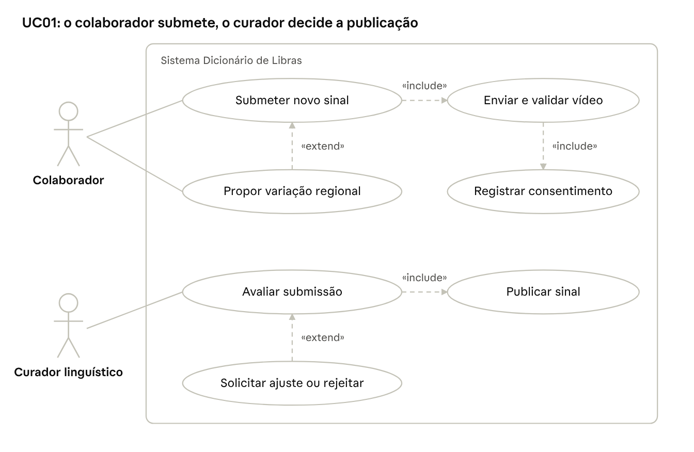
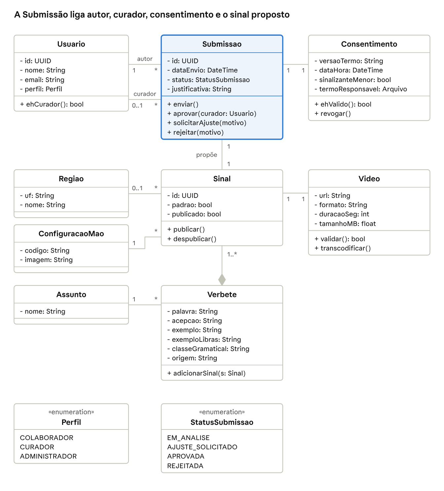
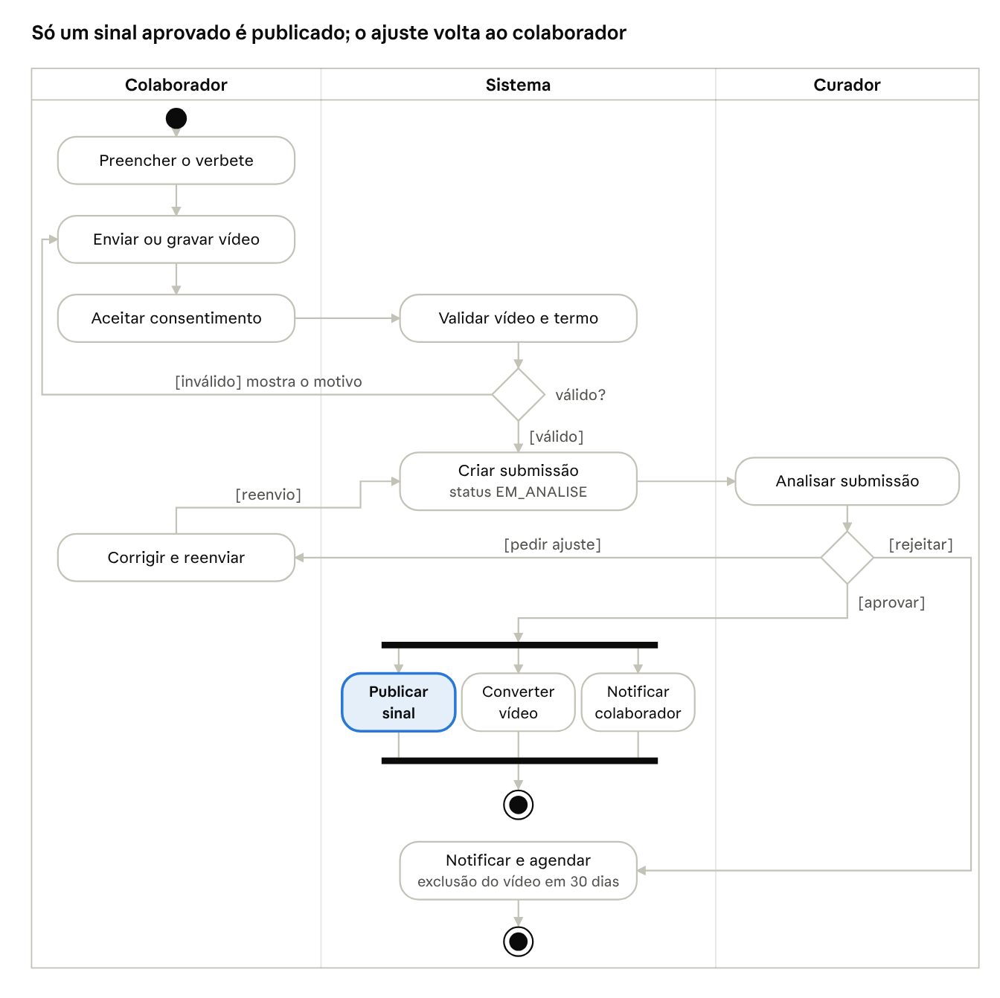
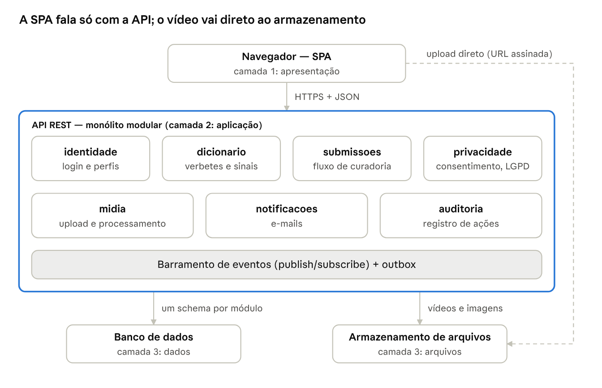

# Apresentação — Expansão do Dicionário de Libras

**AMS0002 – Análise e Modelagem de Sistemas** · Prof.ª Carla Diacui Medeiros Berkenbrock · UDESC

**Equipe:** Gabriel Lima e Eduardo Pasqualeto ·
Repositórios: [documentação](https://github.com/Trabalho-AMS/dicionario-libras),
[backend](https://github.com/Trabalho-AMS/dicionario-libras-backend) e
[frontend](https://github.com/Trabalho-AMS/dicionario-libras-frontend)

## O problema

O [Dicionário de Libras do INES](https://www.ines.gov.br/dicionario-de-libras/) só permite consultar. A expansão
permite **inserir, alterar e excluir** verbetes, registrar **variações regionais** do mesmo sinal e **enviar o
vídeo** do sinal. Toda contribuição passa por um **curador** antes de ser publicada.

## 1. Engenharia de Requisitos

[Documento completo](docs/02-engenharia-de-requisitos.md)

- **Usuários:** Visitante (consulta), Colaborador (envia sinais), Curador linguístico (aprova) e Administrador.
  Cada um tem suas histórias de usuário.
- **Requisitos funcionais:** os pedidos do enunciado viraram RF02 (CRUD do verbete), RF03 (variação regional) e
  RF04 (vídeo de até 30 s e 50 MB). Diferenciais: busca por parâmetros da Libras, mapa de variações, gravação
  pela webcam e player para aprender.
- **Não-funcionais com métricas:** busca em até 1 s com 50 usuários, vídeo tocando em até 2 s, nota ≥ 95 no
  Lighthouse, 0 falhas críticas no OWASP ZAP, 99,5% de uptime e cobertura de testes ≥ 70%.
- **WCAG 2.2 AA:** o público é surdo, então nada depende de áudio; contraste 4,5:1, navegação por teclado e
  descrição textual ao lado de cada vídeo.
- **LGPD:** o vídeo identifica a pessoa, então é tratado como dado sensível. Exige termo de consentimento
  (e do responsável, se menor de 18). Rejeitado: vídeo apagado em 30 dias. Consentimento revogado: sai do ar
  em 24 h.
- **Caso de uso UC01:** submeter e aprovar novo sinal com vídeo.



## 2. Modelagem de Software (UML)

[Documento completo](docs/03-modelagem/README.md) · Os três diagramas modelam o fluxo de aprovação do UC01.

**Classes:** a `Submissao` liga autor, curador, consentimento e sinal. Um `Verbete` tem vários `Sinal`; sem
`Regiao`, é o padrão nacional.



**Sequência:** o colaborador envia; o curador decide. Ao aprovar, o evento `SubmissaoAprovada` aciona mídia,
dicionário e notificações.


**Atividades:** raias de colaborador, sistema e curador. Ajuste e rejeição exigem justificativa.



## 3. Projeto de Software (arquitetura)

[Documento completo](docs/04-arquitetura.md)

**Três camadas**, com SPA no frontend e **monólito modular** no backend: um único processo dividido em 7
módulos (identidade, dicionário, submissões, mídia, privacidade, notificações e auditoria).



**Por quê:** microsserviços seriam caros demais para uma equipe pequena; módulos isolados evitam o código
bagunçado; eventos desacoplam os módulos; e, se o vídeo virar gargalo, o módulo de mídia pode virar
microsserviço sem reescrever o resto.

## 4. Repositório e equipe

| Integrante | Atividades |
|---|---|
| Gabriel Lima | Arquitetura, repositório e documentação, código (em conjunto) |
| Eduardo Pasqualeto | Requisitos, diagramas UML, código (em conjunto) |

Descritivo completo em [docs/05-equipe.md](docs/05-equipe.md).

## 5. Código em funcionamento

**Backend:** Java 17 + Spring Boot, PostgreSQL e bucket S3 no Docker. **Frontend:** Vue 3 + TypeScript.

O código segue o diagrama de classes e a arquitetura: as regras do UC01 estão em `Submissao`, `Video` e
`Consentimento`, cobertas por testes.

```bash
# backend
docker compose up -d && ./mvnw spring-boot:run   # http://localhost:8080
# frontend
npm install && npm run dev                       # http://localhost:5173
```
