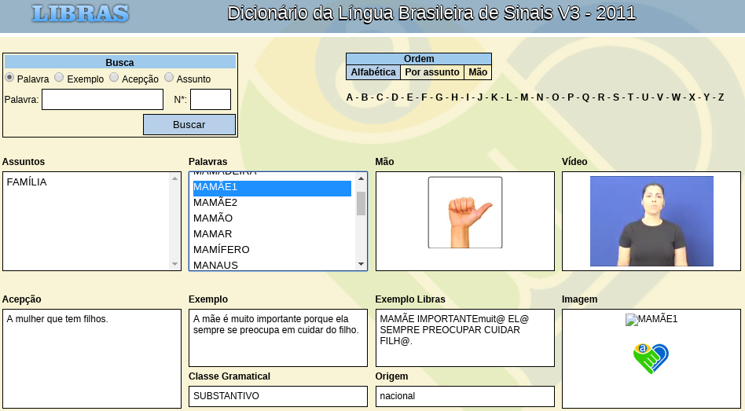
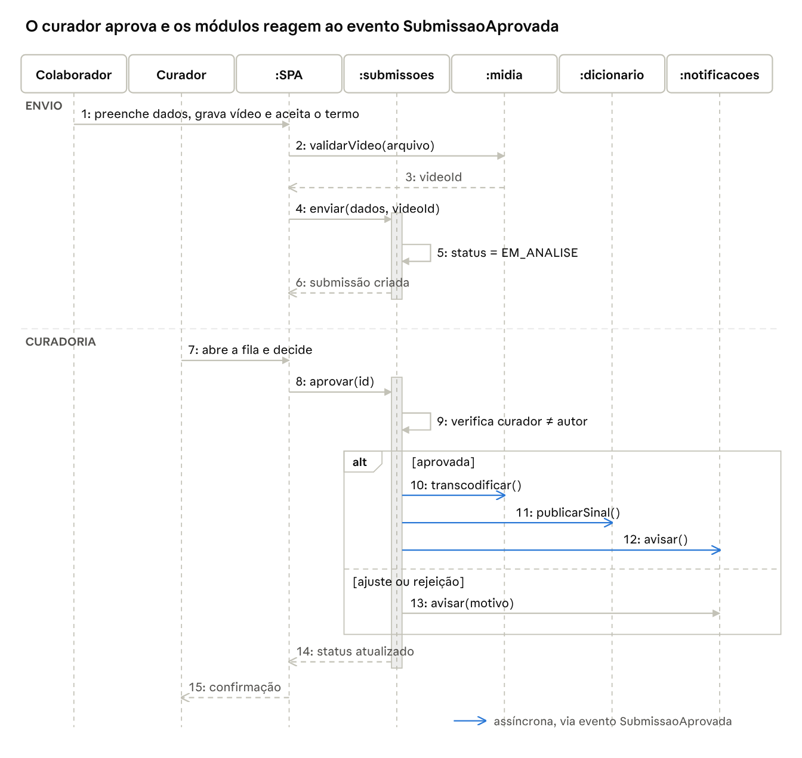

# Apresentação — Expansão do Dicionário de Libras

**AMS0002 – Análise e Modelagem de Sistemas** · Prof.ª Carla Diacui Medeiros Berkenbrock · UDESC

**Equipe:** Gabriel Lima ([@GabrielLima2803](https://github.com/GabrielLima2803)) e
Eduardo Pasqualeto ([@edupasqualeto](https://github.com/edupasqualeto))

| Repositório | Conteúdo |
|---|---|
| [dicionario-libras](https://github.com/Trabalho-AMS/dicionario-libras) | Documentação: requisitos, UML, arquitetura e equipe |
| [dicionario-libras-backend](https://github.com/Trabalho-AMS/dicionario-libras-backend) | API em Java 17 + Spring Boot |
| [dicionario-libras-frontend](https://github.com/Trabalho-AMS/dicionario-libras-frontend) | SPA em Vue 3 + TypeScript |

> Este arquivo segue a ordem dos critérios de avaliação do [enunciado](docs/01-enunciado.md). Cada seção traz
> um quadro **O que falar** com os pontos principais para a apresentação.

## Roteiro

| # | Parte | Critério | Pontos | Quem apresenta |
|---|---|---|---|---|
| 0 | [O problema](#0-o-problema) | — | — | Gabriel |
| 1 | [Engenharia de Requisitos](#1-engenharia-de-requisitos--30) | Etapa 1 | 3,0 | Eduardo |
| 2 | [Modelagem de Software (UML)](#2-modelagem-de-software--20) | Etapa 2 | 2,0 | Eduardo |
| 3 | [Projeto de Software (arquitetura)](#3-projeto-de-software--10) | Etapa 3 | 1,0 | Gabriel |
| 4 | [Repositório e documentação](#4-repositório-e-documentação--10) | Etapa 4 | 1,0 | Gabriel |
| 5 | [Código em funcionamento](#5-código-em-funcionamento--20) | Etapa 5 | 2,0 | Gabriel e Eduardo |
| 6 | [Participação na palestra](#6-participação-na-palestra--10) | Etapa 6 | 1,0 | — |

---

## 0. O problema

O [Dicionário de Libras do INES](https://www.ines.gov.br/dicionario-de-libras/) só permite consultar. O enunciado
pede modelar uma expansão que permita:

1. **inserir, alterar e excluir** todos os campos da ferramenta;
2. registrar a **variação linguística** (o mesmo sinal muda de região para região);
3. **incluir o vídeo** do sinal.



**Nossa proposta:** qualquer pessoa cadastrada pode contribuir com sinais, variações regionais e vídeos, mas
**nada é publicado sem passar por um curador linguístico**. Exemplo: "Pai" tem um sinal padrão nacional e
variações no RJ e no RS, cada uma com seu vídeo.

> **O que falar:** o dicionário atual é só leitura; a expansão transforma ele em algo colaborativo, mas com
> curadoria para manter a qualidade linguística. Esse fluxo de envio e aprovação é o fio condutor de tudo.

---

## 1. Engenharia de Requisitos — 3,0

Documento completo: [docs/02-engenharia-de-requisitos.md](docs/02-engenharia-de-requisitos.md) ·
[PDF](docs/pdf/engenharia-de-requisitos.pdf)

| Critério do enunciado | Atendido em |
|---|---|
| Identificação de usuários e histórias de usuário | [1.1](#11-tipos-de-usuário-e-histórias) |
| Requisitos funcionais e não-funcionais com métricas | [1.2](#12-requisitos-funcionais) e [1.3](#13-requisitos-não-funcionais-e-métricas) |
| Conformidade com WCAG e LGPD | [1.4](#14-acessibilidade--wcag-22-aa) e [1.5](#15-lgpd) |
| Caso de uso estruturado para pelo menos 1 requisito | [1.6](#16-caso-de-uso-uc01) |

### 1.1 Tipos de usuário e histórias

| Perfil | O que faz | História principal |
|---|---|---|
| **Visitante** | Consulta sem login | Quero buscar uma palavra e filtrar por região, para aprender o sinal usado onde moro. |
| **Colaborador** | Envia sinais, variações e correções | Quero enviar um novo sinal com vídeo e acompanhar o status, para incluir um termo que falta. |
| **Curador linguístico** | Especialista indicado pelo INES | Quero uma fila de pendentes para aprovar, pedir ajuste ou rejeitar com justificativa. |
| **Administrador** | Gerencia usuários, tabelas de apoio e pedidos LGPD | Quero gerenciar perfis e tabelas de apoio, para manter o sistema padronizado. |

São 8 histórias no total, todas no [documento de requisitos](docs/02-engenharia-de-requisitos.md#3-histórias-de-usuário).

### 1.2 Requisitos funcionais

| ID | Requisito | Atende ao enunciado |
|---|---|---|
| RF01 | Buscar por palavra, exemplo, acepção e assunto | — |
| **RF02** | Inserir, alterar e excluir **todos os campos** do verbete | Inserção, alteração e exclusão |
| **RF03** | Vários sinais por verbete: um padrão nacional e **variações por região** | Variação linguística |
| **RF04** | **Enviar vídeo** do sinal (MP4/WebM, até 50 MB e 30 s) | Vídeo do sinal |
| RF05 | Toda contribuição fica "Em análise" até ser aprovada | Curadoria |
| RF06 | Curador aprova, pede ajuste ou rejeita (com justificativa) | Curadoria |
| RF07 | Registrar o consentimento do sinalizante | LGPD |
| RF08 | Notificar o colaborador por e-mail ao mudar o status | — |
| RF09 | Histórico de versões do verbete | — |
| RF10 | Gerenciar usuários, perfis e tabelas de apoio | — |

**Diferenciais** (vão além do dicionário original):

| ID | Diferencial | Por quê |
|---|---|---|
| RF11 | Busca pelos **parâmetros da Libras** (configuração de mão, ponto de articulação, movimento, expressão facial) | Achar um sinal sem saber a palavra em português |
| RF12 | **Mapa do Brasil** com a variação de cada estado | Torna a variação linguística visível |
| RF13 | **Gravação pela webcam** com moldura de enquadramento e corte em 30 s | Menos vídeos rejeitados por qualidade |
| RF14 | **Player para aprender**: 0,5x/0,75x, loop, quadro a quadro, espelhar para canhotos | Facilita reproduzir o movimento |

### 1.3 Requisitos não-funcionais e métricas

Cada requisito não-funcional tem uma métrica objetiva para verificar se foi atingido:

| ID | Requisito | Métrica de verificação |
|---|---|---|
| RNF01 | Desempenho da busca | Resposta em até **1 s** com **50 usuários simultâneos** (teste de carga) |
| RNF02 | Carregamento do vídeo | Começa a tocar em até **2 s** numa conexão de 10 Mbps |
| RNF03 | Acessibilidade | **WCAG 2.2 AA**; nota **≥ 95 no Lighthouse** |
| RNF04 | Usabilidade | **90%** dos testadores enviam um sinal sem ajuda em até **5 min** |
| RNF05 | Segurança | HTTPS, senhas com hash e **0 falhas críticas no OWASP ZAP** |
| RNF06 | Disponibilidade | **99,5%** de uptime mensal |
| RNF07 | Manutenibilidade | Cobertura de testes **≥ 70%** nas regras de negócio |

### 1.4 Acessibilidade — WCAG 2.2 AA

O público principal é **surdo**, então o sistema **não depende de áudio** e prioriza conteúdo visual e texto simples:

- texto alternativo em imagens e configurações de mão;
- descrição textual ao lado de cada vídeo;
- contraste mínimo de **4,5:1**;
- navegação completa por teclado, com foco visível;
- mensagens de erro que dizem como corrigir (ex.: *"o vídeo tem 45 s; o limite é 30 s"*).

**Como verificar:** axe DevTools, Lighthouse e teste manual com leitor de tela.

### 1.5 LGPD

O dado mais sensível é o **vídeo do sinal**: mostra rosto e expressões faciais e **identifica a pessoa**.

| Dado | Classificação | Base legal |
|---|---|---|
| Vídeo do sinalizante | Pessoal, **tratado como sensível** | Consentimento específico |
| Vídeo de **menor de 18 anos** | Dado de criança/adolescente (**art. 14**) | Consentimento do **responsável legal** |
| Nome, e-mail e senha | Pessoal | Execução do serviço |
| Logs de acesso | Pessoal | Legítimo interesse (segurança) |

**Consentimento:** o vídeo só é aceito após o aceite do termo de uso de imagem, registrado com data, versão do
termo e quem consentiu. O titular pode **revogar a qualquer momento**.

| Política de descarte | Prazo |
|---|---|
| Submissão rejeitada | Vídeo apagado em **30 dias** |
| Consentimento revogado | Vídeo sai do ar em **24 h** e é excluído em até **15 dias** |
| Logs de acesso | Mantidos por **6 meses** |

### 1.6 Caso de uso UC01

**UC01 – Submeter e aprovar novo sinal com vídeo** (cobre RF02, RF03, RF04, RF05, RF06 e RF07)


| Campo | Descrição |
|---|---|
| Atores | Colaborador e Curador |
| Pré-condição | Colaborador logado |
| Pós-condição | Sinal publicado e visível na busca |

**Fluxo principal**

1. O colaborador escolhe "Enviar novo sinal" e informa a palavra.
2. Preenche os campos do verbete, a região (ou nacional) e envia o vídeo.
3. O sistema valida o vídeo e exibe o termo de consentimento, que o colaborador aceita.
4. O sistema cria a submissão com status "Em análise".
5. O curador abre a submissão na fila, assiste o vídeo e compara com os sinais existentes.
6. O curador aprova; o sistema publica o sinal e notifica o colaborador.

**Fluxos alternativos**

- **Palavra já existe (passo 1):** o sistema sugere enviar como variação regional do verbete existente.
- **Ajuste ou rejeição (passo 6):** o curador escreve a justificativa; o colaborador é notificado e pode corrigir e reenviar.
- **Vídeo inválido (passo 3):** o sistema informa o motivo e mantém os dados preenchidos.

> **O que falar:** os três pedidos do enunciado viraram RF02, RF03 e RF04. Todo RNF tem uma métrica que dá para
> medir. Na LGPD, o ponto-chave é que o vídeo identifica a pessoa, então é tratado como sensível, e menores
> precisam do termo do responsável. O UC01 é o fluxo que modelamos em UML a seguir.

---

## 2. Modelagem de Software — 2,0

Documento completo: [docs/03-modelagem/README.md](docs/03-modelagem/README.md) · [PDF](docs/pdf/diagramas-uml.pdf)

| Critério do enunciado | Atendido em |
|---|---|
| Diagramas UML de Classes, Sequência e Atividades | [2.1](#21-diagrama-de-classes), [2.2](#22-diagrama-de-sequência) e [2.3](#23-diagrama-de-atividades) |
| Mapeamento do fluxo de aprovação de novo sinal com vídeo | Os três diagramas modelam o UC01 |

### 2.1 Diagrama de Classes


- A classe central é a **`Submissao`**: liga o autor, o curador, o consentimento e o sinal proposto.
- Um **`Verbete`** tem um ou mais **`Sinal`** (composição). Um sinal **sem `Regiao`** é o padrão nacional; com
  região, é uma variação.
- **`Consentimento.ehValido()`** concentra a regra da LGPD (termo aceito, não revogado e, se menor, termo do responsável).
- **`Video.validar()`** aplica o RF04 (formato, duração e tamanho).
- A regra *"o curador não pode aprovar a própria submissão"* fica em `aprovar(curador)`.

### 2.2 Diagrama de Sequência



Duas fases: o colaborador **envia** o sinal e, depois, o curador **decide**. Na aprovação, o módulo `submissoes`
publica o evento **`SubmissaoAprovada`**, e os módulos `midia`, `dicionario` e `notificacoes` reagem de forma
assíncrona, sem que `submissoes` precise chamar cada um.

### 2.3 Diagrama de Atividades


- Raias separam o que cabe ao **colaborador**, ao **sistema** e ao **curador**.
- Na aprovação, publicar o sinal, converter o vídeo e notificar acontecem **em paralelo**.
- Pedir ajuste ou rejeitar **exige justificativa**; na rejeição, o vídeo é agendado para exclusão em **30 dias** (LGPD).
- Sinalizante **menor de 18 anos sem o termo do responsável** torna a submissão inválida.

> **O que falar:** os três diagramas contam a mesma história do UC01 de ângulos diferentes: o que existe
> (classes), quem conversa com quem (sequência) e o passo a passo com decisões (atividades). Os nomes das
> classes e módulos são os mesmos da arquitetura e do código.

---

## 3. Projeto de Software — 1,0

Documento completo: [docs/04-arquitetura.md](docs/04-arquitetura.md) · [PDF](docs/pdf/proposta-de-arquitetura.pdf)

| Critério do enunciado | Atendido em |
|---|---|
| Proposta fundamentada de um padrão arquitetural | [3.1](#31-padrão-escolhido) |
| Justificativas voltadas ao sucesso a longo prazo | [3.2](#32-justificativa) |

### 3.1 Padrão escolhido

**Três camadas**, com frontend e backend separados:

- **Frontend:** SPA organizada por páginas.
- **Backend:** **monólito modular**, um único processo dividido em módulos independentes, cada um dono das
  suas regras e dos seus dados.


| Módulo | Responsabilidade |
|---|---|
| `identidade` | Cadastro, login e perfis |
| `dicionario` | Verbetes, sinais, variações regionais e busca |
| `submissoes` | Envio de contribuições e curadoria |
| `midia` | Upload, validação e processamento de vídeo |
| `privacidade` | Consentimento e descarte de dados (LGPD) |
| `notificacoes` | E-mails ao usuário |
| `auditoria` | Registro das ações |

Cada módulo tem as mesmas camadas internas: `http` (rotas), `aplicacao` (casos de uso), `dominio` (regras de
negócio) e `infra` (banco e arquivos).

### 3.2 Justificativa

| Decisão | Por quê |
|---|---|
| **Não usar microsserviços agora** | Para uma equipe pequena e um sistema deste tamanho, o custo de rede, deploy e transações distribuídas não compensa |
| **Módulos isolados** | Um módulo só usa outro pela interface pública e nunca acessa tabelas alheias; o sistema cresce sem virar um bloco difícil de manter |
| **Eventos entre módulos** | Ao aprovar uma submissão, um evento avisa os interessados (publicar, processar vídeo, notificar, auditar) sem acoplamento |
| **SPA no frontend** | Player, gravação pela webcam e mapa funcionam sem recarregar; a mesma API pode atender um app móvel |
| **Pronto para crescer aos poucos** | Se o vídeo virar gargalo, o módulo `midia` vira microsserviço sem reescrever o resto, porque já usa eventos e dados próprios |

> **O que falar:** escolhemos o meio-termo: a simplicidade de um monólito com a organização de microsserviços.
> O argumento de longo prazo é que o caminho para extrair um módulo já está pronto, sem pagar esse custo hoje.

---

## 4. Repositório e documentação — 1,0

| Critério do enunciado | Atendido em |
|---|---|
| Link válido do repositório com README.md estruturado | https://github.com/Trabalho-AMS/dicionario-libras ([README](README.md)) |
| Descritivo explícito de atividades por membro | [docs/05-equipe.md](docs/05-equipe.md) |

**Organização no GitHub:** [Trabalho-AMS](https://github.com/Trabalho-AMS), com três repositórios
(documentação, backend e frontend), cada um com seu README.

### Atividades por membro

| Etapa | Responsável |
|---|---|
| 1. Engenharia de Requisitos | Eduardo Pasqualeto |
| 2. Modelagem de Software (UML) | Eduardo Pasqualeto |
| 3. Projeto de Software (arquitetura) | Gabriel Lima |
| 4. Repositório e documentação | Gabriel Lima |
| 5. Código em funcionamento | Gabriel Lima e Eduardo Pasqualeto (em conjunto) |

O descritivo detalhado de cada membro está em [docs/05-equipe.md](docs/05-equipe.md).

---

## 5. Código em funcionamento — 2,0

| Critério do enunciado | Onde |
|---|---|
| Protótipo com as operações essenciais (CRUD e upload) | [backend](https://github.com/Trabalho-AMS/dicionario-libras-backend) e [frontend](https://github.com/Trabalho-AMS/dicionario-libras-frontend) |

### Stack

| Camada | Tecnologias |
|---|---|
| Backend | Java 17, Spring Boot (Web, Data JPA, Validation), Flyway, MapStruct, Lombok, springdoc-openapi (Swagger) |
| Banco e arquivos | PostgreSQL 17 e bucket S3 (SeaweedFS), ambos no Docker |
| Frontend | Vue 3, Vite, TypeScript, Vue Router, Pinia, PrimeVue, Axios, VeeValidate + Zod |
| Testes | JUnit 5, AssertJ, Testcontainers (backend) e Vitest (frontend) |

### Do diagrama ao código

O backend segue a arquitetura: cada módulo é um pacote (`br.udesc.dicionariolibras.<modulo>`) com as camadas
`http`, `aplicacao`, `dominio` e `infra`. As classes do diagrama viraram entidades com as mesmas regras:

| Classe | Regra implementada | Requisito |
|---|---|---|
| `Verbete.adicionarSinal()` | No máximo um sinal padrão publicado por verbete | RF03 |
| `Video.validar()` | MP4/WebM, até 30 s e 50 MB, com mensagem de como corrigir | RF04, WCAG |
| `Consentimento.ehValido()` | Termo aceito, não revogado e, se menor de 18, termo do responsável | RF07, LGPD |
| `Submissao.enviar()` | Só envia com consentimento válido; status vai para `EM_ANALISE` | RF05 |
| `Submissao.aprovar()` | Só curador aprova, e nunca a própria submissão; dispara `SubmissaoAprovada` | RF06 |
| `Submissao.solicitarAjuste()` / `rejeitar()` | Exigem justificativa; disparam `SubmissaoDevolvida` | RF06 |

- Módulos diferentes se referenciam **pelo id**, sem chave estrangeira entre eles, como pede a arquitetura.
- O banco é criado pelas migrações do Flyway: 9 tabelas, com as 27 UFs e os assuntos como dados iniciais.
- Os vídeos ficam no bucket S3 e são acessados por URL temporária assinada.
- As regras de negócio têm testes de unidade, e o repositório de submissões tem teste de integração com um
  PostgreSQL real (Testcontainers).

### Como rodar a demonstração

```bash
# Backend (requer Java 17 e Docker)
cd dicionario-libras-backend
docker compose up -d          # PostgreSQL (5433) e bucket S3 (8333)
./mvnw spring-boot:run        # API em http://localhost:8080
./mvnw test                   # testes

# Frontend (requer Node.js 22.18+)
cd dicionario-libras-frontend
npm install
npm run dev                   # http://localhost:5173
```

- Status da API: http://localhost:8080/api/status
- Documentação da API (Swagger): http://localhost:8080/swagger-ui.html

### Situação do protótipo

| Parte | Situação |
|---|---|
| Estrutura modular do backend, entidades e regras do diagrama de classes | ✅ Pronto |
| Banco (migrações) e bucket S3 no Docker | ✅ Pronto |
| Testes das regras de negócio | ✅ Pronto |
| Estrutura do frontend (rotas das 6 páginas e serviço único de API) | ✅ Pronto |
| Endpoints da API (CRUD de verbete, upload de vídeo, curadoria) | 🚧 Em andamento |
| Telas de CRUD, envio de sinal com vídeo e curadoria | 🚧 Em andamento |

> **O que falar:** mostrar que o código é o diagrama de classes rodando: abrir `Submissao.java` e apontar as
> regras do UC01. Rodar `./mvnw test` para mostrar as regras sendo verificadas. Depois, demonstrar o fluxo pelo
> frontend: cadastrar um verbete, enviar um sinal com vídeo e aprovar como curador.
> **Atualize a tabela acima** conforme os endpoints e as telas ficarem prontos.

---

## 6. Participação na palestra — 1,0

**"Modelagem de Sistemas Baseados em IA: Decisão Autônoma, Aprendizado e Autodescrição"**,
24/11/2026, às 13:30. Os dois integrantes precisam participar.

---

## Checklist final

| # | Etapa | Pontos | Entregue |
|---|---|---|---|
| 1 | Usuários e histórias · RF e RNF com métricas · WCAG e LGPD · caso de uso UC01 | 3,0 | ✅ |
| 2 | Diagramas de Classes, Sequência e Atividades do fluxo de aprovação | 2,0 | ✅ |
| 3 | Padrão arquitetural com justificativas de longo prazo | 1,0 | ✅ |
| 4 | Repositório com README estruturado · atividades por membro | 1,0 | ✅ |
| 5 | Protótipo com CRUD e upload | 2,0 | 🚧 |
| 6 | Palestra de 24/11/2026 | 1,0 | ⏳ |

**Diretrizes finais:**

- [x] Equipe de até quatro acadêmicos (somos dois)
- [ ] Documento no Moodle com o descritivo de atividades por membro e o link do repositório
- [ ] Apresentação na sala 202C-32, no horário agendado
