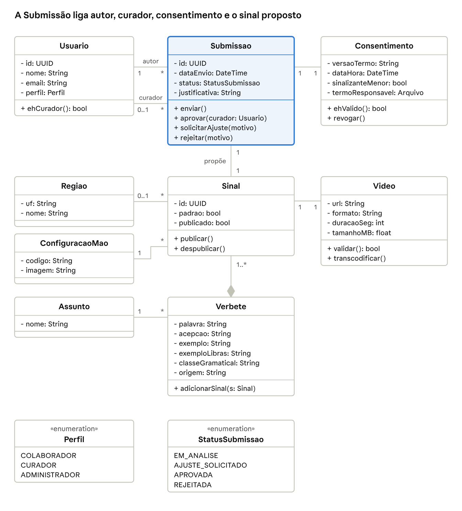
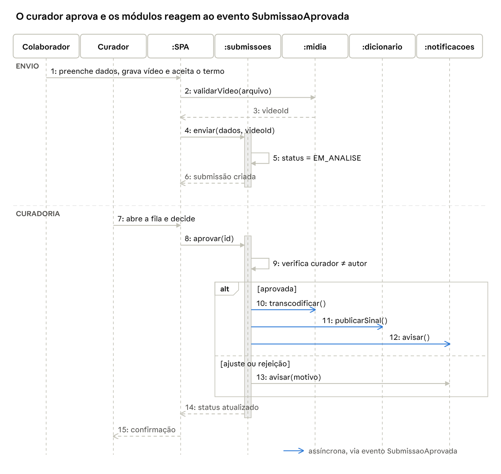
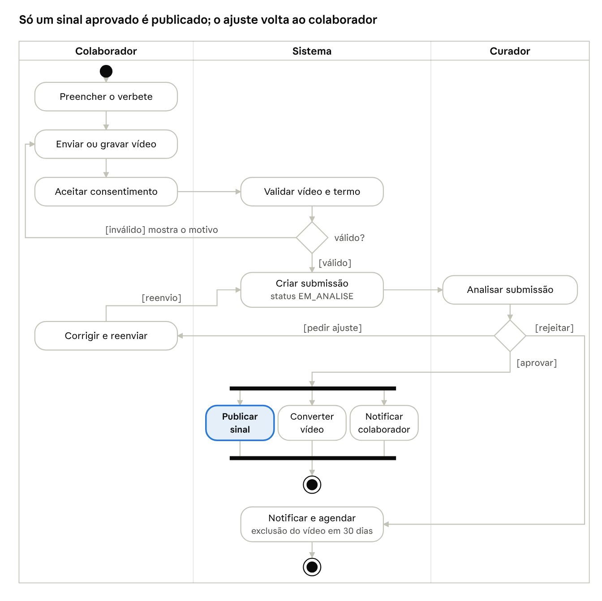

# Modelagem de Software (UML)

> Responsável: Eduardo Pasqualeto ([@edupasqualeto](https://github.com/edupasqualeto))
>
> Original: [PDF](../pdf/diagramas-uml.pdf)

Os três diagramas modelam o **fluxo de aprovação de um novo sinal com vídeo**, descrito no caso de uso
[UC01 – Submeter e aprovar novo sinal com vídeo](../02-engenharia-de-requisitos.md#8-caso-de-uso-uc01--submeter-e-aprovar-novo-sinal-com-vídeo),
conforme a etapa 2.2 do [enunciado](../01-enunciado.md). O colaborador envia o sinal com vídeo e consentimento,
e o curador aprova, pede ajuste ou rejeita. Os nomes de classes e módulos seguem a
[proposta de arquitetura](../04-arquitetura.md) (monólito modular).

| Diagrama | Arquivo |
|---|---|
| Diagrama de Classes | [classes.png](classes.png) |
| Diagrama de Sequência | [sequencia.png](sequencia.png) |
| Diagrama de Atividades | [atividades.png](atividades.png) |

## 1. Diagrama de Classes

A classe central do fluxo é a `Submissao`: ela liga o colaborador (autor) e o curador, guarda o consentimento e
propõe um `Sinal`. Um `Verbete` tem um ou mais sinais (composição); um `Sinal` sem `Regiao` é o sinal padrão
nacional.

| Classe | Papel no fluxo |
|---|---|
| `Usuario` | Autor ou curador da submissão; o `Perfil` define o que pode fazer |
| `Submissao` | Contribuição enviada para curadoria, com status e justificativa |
| `Consentimento` | Termo aceito pelo sinalizante (e pelo responsável legal, se menor de idade) |
| `Sinal` | Sinal proposto, com região, configuração de mão e vídeo |
| `Video` | Arquivo do sinal, validado no envio e transcodificado na aprovação |
| `Verbete` | Palavra do dicionário, com acepção, exemplos e um ou mais sinais |
| `Regiao`, `ConfiguracaoMao`, `Assunto` | Dados de apoio para variações regionais e busca por parâmetros |
| `Perfil`, `StatusSubmissao` | Enumerações de perfis de usuário e estados da submissão |

A regra "o curador não pode aprovar a própria submissão" fica no método `aprovar(curador)`, que compara o
curador com o autor antes de mudar o status.

## 2. Diagrama de Sequência

O diagrama mostra as duas fases do fluxo: o colaborador envia o sinal e, depois, o curador decide. Na
aprovação, o módulo `submissoes` publica o evento `SubmissaoAprovada` e os módulos `midia`, `dicionario` e
`notificacoes` reagem de forma assíncrona.

## 3. Diagrama de Atividades

O diagrama separa em raias o que cabe ao colaborador, ao sistema e ao curador. Na aprovação, publicar o sinal,
converter o vídeo e notificar o colaborador acontecem em paralelo. Pedir ajuste ou rejeitar exige justificativa
do curador; na rejeição, o vídeo é agendado para exclusão em 30 dias.

Na validação, um sinalizante menor de 18 anos sem o termo do responsável legal torna a submissão inválida (LGPD).
