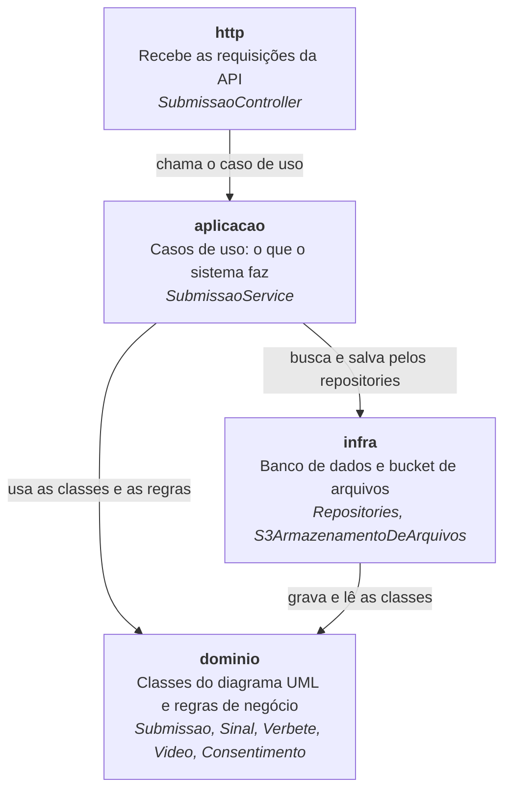

# Proposta de Arquitetura

> Original: [PDF](pdf/proposta-de-arquitetura.pdf)

## 1. Visão geral
O sistema usa **três camadas** com frontend e backend separados. O frontend é uma **SPA** simples, organizada por
páginas. O backend é um **monólito modular**: roda como um único processo, mas é dividido em módulos independentes,
cada um dono das suas regras e dos seus dados.

## 2. Justificativa
- **Microsserviços seriam complexos demais agora.** Para uma equipe pequena e um sistema desse tamanho, o custo de
  rede, deploy e transações distribuídas não compensa. Seguimos a recomendação de começar com um monólito.
- **Módulos isolados evitam o monólito bagunçado.** Um módulo só usa outro pela interface pública dele e nunca
  acessa tabelas alheias. Assim o sistema cresce sem virar um bloco único difícil de manter.
- **Eventos desacoplam os módulos.** Quando uma submissão é aprovada, um evento avisa os interessados (publicar o
  sinal, processar o vídeo, notificar e auditar), sem um módulo chamar todos os outros.
- **A SPA deixa a interface responsiva.** Player, gravação pela webcam e mapa funcionam sem recarregar a página, e a
  mesma API pode atender um app móvel no futuro.
- **Pronto para crescer aos poucos.** Se o processamento de vídeo virar gargalo, o módulo de mídia é extraído como
  microsserviço sem reescrever o resto, porque já funciona por eventos e com dados próprios.

## 3. Módulos do backend

| Módulo | Responsabilidade |
|---|---|
| `identidade` | Cadastro, login e perfis |
| `dicionario` | Verbetes, sinais, variações regionais e busca |
| `submissoes` | Envio de contribuições e curadoria |
| `midia` | Upload, validação e processamento de vídeo |
| `privacidade` | Consentimento e descarte de dados (LGPD) |
| `notificacoes` | E-mails ao usuário |
| `auditoria` | Registro das ações |

### Camadas de cada módulo

Cada módulo tem as mesmas quatro pastas:

| Pasta | O que significa | Usa |
|---|---|---|
| `http` | Porta de entrada: recebe a requisição, valida o formato dos dados e devolve a resposta em JSON. Não tem regra de negócio. | `aplicacao` |
| `aplicacao` | Casos de uso: coordena os passos de cada operação (criar, listar, alterar, excluir), usando as classes do domínio e os repositories. | `dominio` e `infra` |
| `dominio` | Coração do módulo: as classes do diagrama UML com seus atributos e regras de negócio. Não depende de nenhuma outra pasta. | nenhuma |
| `infra` | Detalhes técnicos: repositories (PostgreSQL com JPA) e o armazenamento dos vídeos no bucket S3. | `dominio` |

O protótipo implementa só o CRUD de submissões, então só existem os módulos e as pastas que ele usa:

| Módulo | `http` | `aplicacao` | `dominio` | `infra` |
|---|---|---|---|---|
| `submissoes` | `SubmissaoController` | `SubmissaoService` | `Submissao`, `StatusSubmissao` | `SubmissaoRepository` |
| `dicionario` | — | — | `Verbete`, `Sinal`, `Regiao`, `ConfiguracaoMao`, `Assunto` | `VerbeteRepository`, `RegiaoRepository`, `AssuntoRepository`, `ConfiguracaoMaoRepository` |
| `midia` | — | — | `Video` | `S3ArmazenamentoDeArquivos` (bucket) |
| `privacidade` | — | — | `Consentimento` | — |

O `SubmissaoService` coordena o CRUD usando as classes e os repositories dos outros módulos. `identidade`,
`notificacoes` e `auditoria` entram quando houver login, e-mails e registro de ações.

**Regra:** as setas mostram quem pode usar quem. O `http` só conversa com a `aplicacao`, nunca acessa o banco
ou as classes do domínio direto. O `dominio` não depende de ninguém: as regras não sabem que existe banco,
bucket ou API. A regra é verificada automaticamente pelo teste `CamadasTest` do backend.

**Exemplo, enviar um sinal:** `SubmissaoController` recebe o formulário → `SubmissaoService.criar()` →
`Video.validar()` (mídia) e `Consentimento.ehValido()` (privacidade) conferem as regras →
`Verbete.adicionarSinal()` (dicionário) → `SubmissaoRepository` grava no PostgreSQL e o vídeo vai para o bucket.

O pacote `compartilhado` fica fora dessa regra: tem só configuração comum (CORS, Swagger) e o tratamento de
erros usado por todos os módulos.

## 4. Frontend
SPA organizada por páginas — busca, verbete, enviar sinal, minhas submissões, curadoria e administração — com
alguns componentes compartilhados: player, gravador de webcam, mapa de variações e busca por parâmetros.
Toda comunicação com o backend passa por um único serviço de API.
